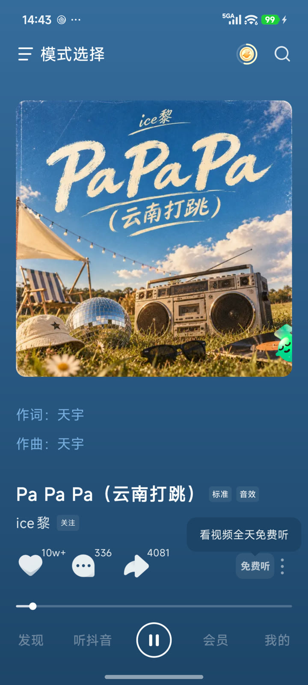
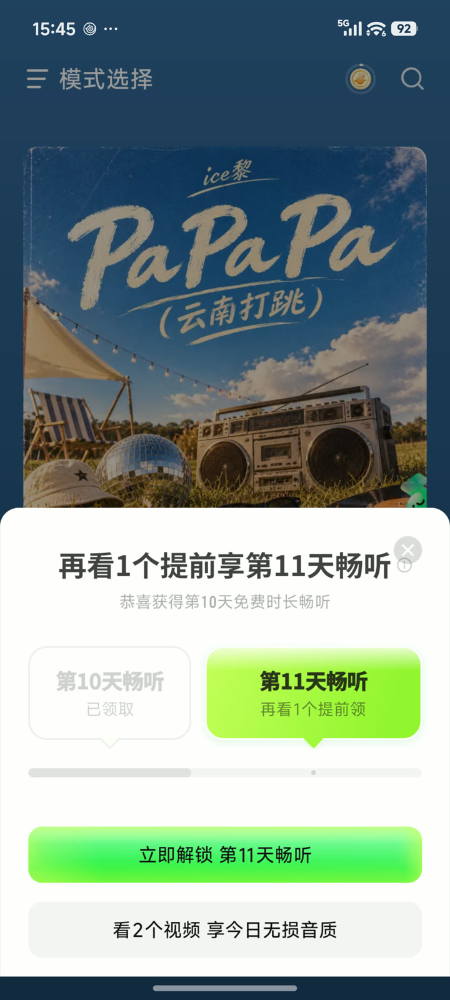
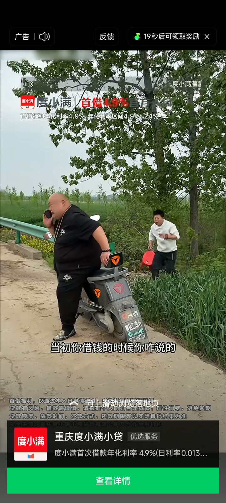
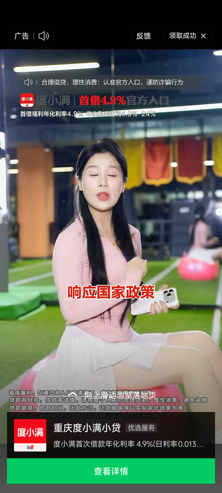
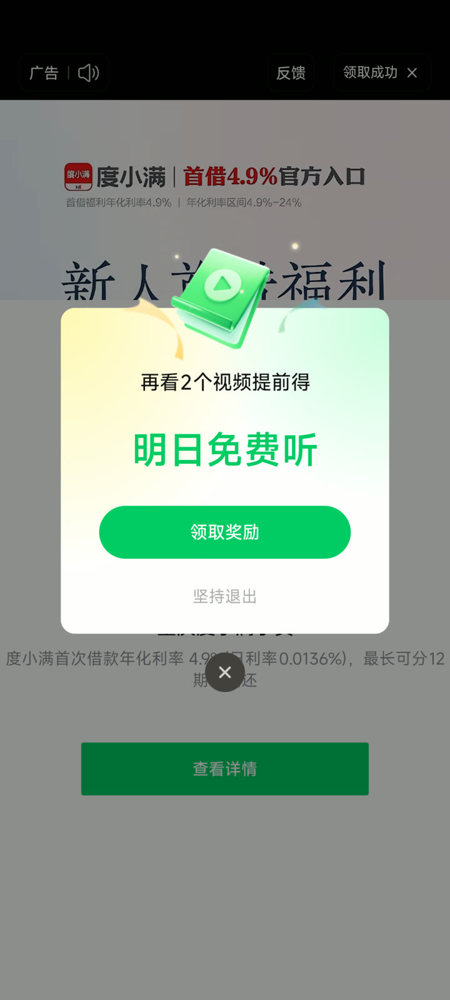

# 汽水音乐自动领时长（Android）

> 让电脑帮你盯广告：adb 截屏 + OCR 识别 + 模拟点击，全自动刷汽水音乐「看广告领免费听」。

  

## 演示

| 场景 | 截图 |
|------|------|
| 开屏广告自动跳过 |  |
| 主界面免费听入口 |  |
| 解锁弹窗（第 N 天畅听） |  |
| 广告倒计时 |  |
| 倒计时结束「领取成功」 |  |
| 「领取奖励」弹窗 |  |
| 直播间广告自动清理 |  |

实测日志（小米 15 Pro，单日）：连续 28+ 轮全自动领取，中途直播间广告自动关闭并续跑。

完整录屏演示（30s）：[assets/demo.mp4](assets/demo.mp4)

## 原理

```
┌──────────┐   adb screencap   ┌──────────────┐
│ Android  │ ────────────────▶ │ Python 脚本   │
│  手机     │ ◀──────────────── │ (电脑/手机旁) │
└──────────┘   adb input tap   └──────┬───────┘
                                      │ OCR (RapidOCR)
                              识别「领取成功」「领取奖励」
```

纯视觉方案：不抓包、不注入、不改 App，就是「截图 → 认字 → 点一下」，循环。

已处理的坑：

- **直播间广告**：识别「更多直播/人气榜/本场点赞」特征 → 自动收券（开心收下）→ 关直播 → 回播放页重新点「立即解锁」续跑
- **无线调试断线**：`adb mdns services` 自动发现设备并重连
- **「第 N 天畅听」文案漂移**：活动文案从「今日畅听」变「第 11 天畅听」，关键词按通用文案匹配
- **空闲保护**：连续 3 次截屏无广告页特征快速失败，连续 10 轮无奖励自动退出，防死循环

## 环境要求

| 项 | 要求 |
|----|------|
| 手机 | Android，开启 **USB 调试**；小米/红米还需开启「**USB 调试（安全设置）**」，否则 `input tap` 会被系统拒绝（`INJECT_EVENTS` 权限错误） |
| 电脑 | Windows / macOS / Linux，安装 [platform-tools](https://developer.android.com/tools/releases/platform-tools)（adb 在 PATH，或用 `ADB_PATH` 环境变量指定） |
| Python | 3.10+ |

```bash
pip install rapidocr-onnxruntime opencv-python
```

## 使用方法

1. 手机开启无线调试（设置 → 开发者选项 → 无线调试），与电脑同一局域网
   （USB 连接也行，手机弹「允许 USB 调试」时勾选「一律允许」）
2. 运行：

```bash
python qishui_auto.py
```

Windows 也可以双击 `run.bat`。

脚本启动后自动：启动 App → 跳开屏广告 → 点解锁进广告 → 一轮轮领取 → 领满自动停。`Ctrl+C` 随时中断。

## 配置

所有坐标在 `qishui_auto.py` 顶部常量区，按 **1440×3200** 标定。换分辨率请按自己手机重新标定：

```python
REG_TOPBAR = (0, 130, 1440, 340)      # 开屏跳过 + 广告顶「领取成功」识别区
BTN_CLAIM_OK = (1150, 232)            # 「领取成功」点击位置
...
```

标定方法：对手机截屏（`adb exec-out screencap -p > screen.png`），量出按钮中心像素。

## 免责声明

- 本项目仅供学习交流自动化技术，**不代表鼓励薅取平台权益**
- 自动化操作违反汽水音乐用户协议，可能导致账号风控，**使用后果自负**
- 请勿用于任何商业用途

## 同类参考

- [qishuiAScriptProject](https://github.com/wei6718189/qishuiAScriptProject) — iOS 版思路来源（AScript + WDA + OCR），本项目是其 Android 移植
